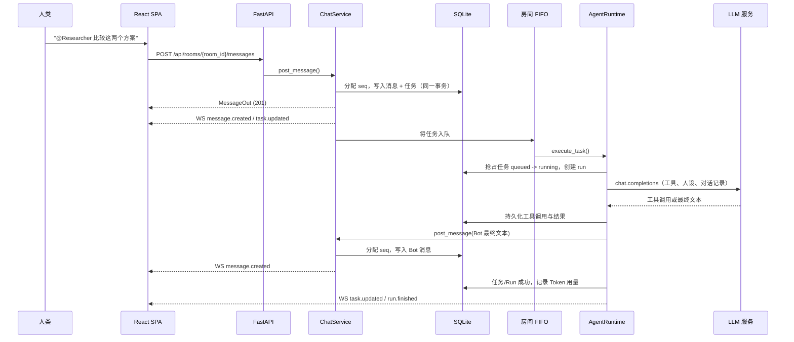
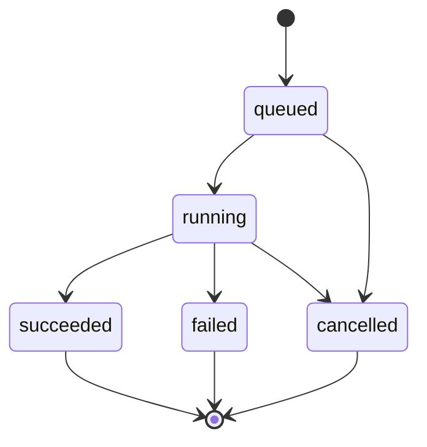

# AI Chat Room

`ai_chat_room` 是一个人类与 AI Bot 共享同一个聊天室的工作空间。用 `@Name` 提及 Bot 后，它会收到一个持久化任务，按需调用工具，并把回复写回同一条对话记录。Bot 之间可以通过一条可见的委派消息交接工作。所有消息、任务、运行记录和工具调用都会写入数据库。

当前项目是一个 MVP：FastAPI 后端加 React 单页前端，按单进程本地服务设计，尚未针对公网或多租户场景做安全加固。

- **后端：** Python 3.12、FastAPI、SQLAlchemy 2 async、SQLite、OpenAI 兼容的 Chat Completions
- **前端：** React 19、TypeScript、Vite、`oxlint`
- **实时通信：** WebSocket 仅做服务端推送；所有写操作走 REST
- **存储：** SQLite（WAL），完整记录 Run 与工具调用
- **许可证：** MIT

相关文档：

- [`AGENTS.md`](AGENTS.md) —— 贡献者与编码 Agent 指南：命令、架构约束、修改流程、测试要求
- [`DEPLOYMENT.md`](DEPLOYMENT.md) —— 最简部署：一键启动、模型配置、备份与升级
- [`backend/README.md`](backend/README.md) —— 后端速查
- [`frontend/README.md`](frontend/README.md) —— 前端速查

## 目录

- [功能特性](#功能特性)
- [消息如何变成回复](#消息如何变成回复)
- [架构](#架构)
- [快速开始](#快速开始)
- [Docker Compose 一键启动](#docker-compose-一键启动)
- [配置](#配置)
- [使用指南](#使用指南)
- [HTTP API](#http-api)
- [WebSocket 协议](#websocket-协议)
- [数据模型](#数据模型)
- [Agent 运行时](#agent-运行时)
- [内置工具](#内置工具)
- [安全与限制](#安全与限制)
- [测试](#测试)
- [项目结构](#项目结构)
- [开发说明](#开发说明)
- [故障排查](#故障排查)
- [路线图](#路线图)
- [许可证](#许可证)

## 功能特性

- 在界面中配置模型 Provider、Base URL、API Key 和默认模型；保存后对后续任务立即生效，无需重启。
- 创建 Bot：名称、描述、人设、可选的模型覆盖、温度、工具白名单、步数上限。
- 创建房间并选择参与的 Bot；之后可以随时添加或移除。
- 用 `@Name` 提及 Bot。每个被提及且属于房间成员的 Bot 都会获得一个深度为 `0` 的持久化任务。
- 输入框支持 Bot 提及自动补全和键盘导航。
- Bot 与人类使用同一条对话记录，消息带 AI 标记，并显示关联任务状态。
- 内置工具：`get_room_history`、`delegate_to_bot`、`fetch_url`。
- 委派会先发出一条可见的 `@目标Bot 指令` 消息，再创建子任务；结果回到同一个房间。
- 每个房间使用 FIFO 调度，保证消息顺序和 Agent 上下文确定性。
- 任务记录包含状态、父子/根任务、深度、运行记录、模型、Token 用量、工具调用、错误和时间戳。
- 支持任务取消、重启恢复、步数/深度/单根任务数限制。
- WebSocket 断线重连后会重新拉取数据补齐；当前房间可实时看到 Agent 活动。
- 响应式三栏界面，窄屏使用抽屉式侧栏，跟随操作系统的浅色/深色外观。
- 界面支持中文/英文切换，默认中文；语言偏好保存在浏览器 `localStorage` 中。
- 使用脚本化 LLM 的确定性集成测试，不访问网络，也不需要 API Key。

## 消息如何变成回复



任务树示例：

```text
根任务（深度 0，人类提及触发）
├── 子任务（深度 1，delegate_to_bot）
│   └── 子任务（深度 2）
└── 子任务（深度 1）
```

同一个房间的所有任务共用一个 FIFO 队列，因此被委派的子任务要等发起委派的任务结束后才会执行。父任务可以在子任务结果出现之前就完成。

## 架构

```text
┌────────────┐    REST 写入      ┌───────────────┐
│ React SPA  │ ─────────────────► │ FastAPI       │
│            │                    │               │
│            │ ◄───────────────── │ WebSocket Hub │
└────────────┘   房间事件推送      └───────┬───────┘
                                           │
                                    ┌──────▼────────┐
                                    │ Chat Service  │
                                    │ seq + 提及解析 │
                                    │ 任务路由      │
                                    └──────┬────────┘
                                           │
                     ┌─────────────────────┼─────────────────────┐
                     │                     │                     │
               ┌─────▼─────┐        ┌──────▼──────┐       ┌──────▼──────┐
               │ SQLite    │        │ 房间队列    │       │ 工具调用    │
               │ messages  │        │ FIFO Worker │       │ 审计记录    │
               │ tasks     │        └──────┬──────┘       └─────────────┘
               │ runs      │               │
               └───────────┘        ┌──────▼──────┐
                                    │ Agent 循环  │
                                    │ LLM + 工具  │
                                    └──────┬──────┘
                                           │
                                  OpenAI 兼容 API
```

设计原则：

1. **房间对话记录是共享事实来源。** 人类和 Bot 都通过同一个 `ChatService` 写入，确保顺序、提及和任务关联一致。
2. **Bot 调用是持久化任务，不是一次 HTTP 请求。** 客户端断线或服务重启不会抹掉排队中的工作。
3. **每次执行尝试是一条 Run。** 工具调用挂在 Run 下，便于审计和排查。
4. **写操作走 REST，WebSocket 只负责推送。** 校验和错误处理集中在一处。
5. **每个房间的 Bot 回合串行执行。** 消息按房间内的 `seq` 排序；同一房间同一时间只执行一个 Agent 任务。
6. **Bot 在文本里写的普通提及只是信息。** 只有 `delegate_to_bot` 工具会创建子任务，避免 Bot 的最终回复重复制造工作。
7. **提交后再广播。** WebSocket 是尽力而为的通知，不是事实来源；客户端重连后通过 REST 补齐。

启动时，处于 `running` 的任务和 Run 会被标记为失败，`queued` 任务会重新入队，预设用户不存在时会自动创建。

MVP 以**单进程**运行：调度器和 WebSocket 广播都在内存中。不要对同一个 SQLite 文件启动多个后端 Worker。

## 快速开始

> 只想直接运行：使用 [Docker Compose 一键启动](#docker-compose-一键启动)，无需本地安装 Python/Node。

### 环境要求

- [uv](https://docs.astral.sh/uv/)
- Python 3.12（也可以让 uv 安装）
- Node.js 20.19+ 或 22.12+
- 一个 OpenAI 兼容的 Chat Completions 接口和 API Key（也可以在首次启动后通过界面 **Model settings** 配置）

### 启动后端

```bash
cd backend
uv sync
uv run uvicorn app.main:app --reload
```

`.env` 是可选的。API Key、Base URL 和默认模型可以直接在界面的 **Model settings** 中配置；首次启动时如果存在 `LLM_*` 环境变量，会作为初始值写入数据库。

API 地址为 http://127.0.0.1:8000，交互式文档在 http://127.0.0.1:8000/docs。SQLite 默认位于 `backend/data/app.db`，首次启动时自动创建。

验证后端：

```bash
curl http://127.0.0.1:8000/api/health
```

```json
{
  "status": "ok",
  "app": "AI Chat Room",
  "version": "0.1.0",
  "environment": "development",
  "llm_configured": true
}
```

如果 `llm_configured` 为 `false`，界面和消息记录仍然可用，但 Bot 任务会因缺少配置而失败。点击左下角的设置按钮，填写 API Key、Base URL 和模型后保存即可，无需重启。

### 启动前端

另开一个终端：

```bash
cd frontend
npm install
npm run dev
```

打开 http://127.0.0.1:5173。Vite 会把 `/api` 和 `/ws` 代理到 `http://127.0.0.1:8000`。

### 初次使用

1. 点击左下角的 **Model settings**，填写 Provider、API Key、Base URL 和默认模型并保存（如果已通过 `LLM_*` 播种可跳过）。
2. 在右侧 **Agents** 面板创建一个 Bot。
3. 在左侧创建一个房间，并勾选该 Bot。
4. 在输入框发送 `@BotName 你好`。
5. 观察 Bot 消息出现，然后在 **Tasks** 中查看任务详情。

从房间的 **Agents** 面板创建 Bot 时，前端会顺手把它加入当前房间；通过 REST API 创建的 Bot 需要单独加入房间。

### 重置开发数据

先停止后端，再删除 `backend/data/app.db`（以及可能存在的 `-wal` / `-shm` 文件）。下次启动会创建空表、重新写入预设用户，并用当前 `LLM_*` 环境变量重新播种模型配置。已通过界面保存的模型配置和 API Key 也会一并清空。

## Docker Compose 一键启动

如果只想运行应用，不需要本地安装 Python 和 Node，可以直接用 Docker Compose。需要 Docker Engine（或 Docker Desktop）和 Compose v2.24+。

仓库包含：

- `backend/Dockerfile`：Python 3.12 + uv，以非 root 用户运行，单 Worker
- `frontend/Dockerfile`：Node 构建 + nginx 静态服务
- `frontend/nginx.conf`：同源代理 `/api`、`/ws`、`/docs`、`/openapi.json`
- `docker-compose.yml`：后端、前端、健康检查和持久化数据卷
- `start.ps1` / `start.cmd` / `start.sh`：构建、启动并等待健康检查

### Windows

在仓库根目录执行：

```powershell
.\start.ps1
```

也可以直接双击 `start.cmd`（会绕过 PowerShell 执行策略并在结束时保留窗口）。指定其他端口：

```powershell
.\start.ps1 -Port 9090
```

如果直接运行 `.ps1` 被执行策略拦截：

```powershell
powershell -ExecutionPolicy Bypass -File .\start.ps1
```

### Linux / macOS

```bash
./start.sh
```

指定其他端口：

```bash
./start.sh 9090
# 或
APP_PORT=9090 ./start.sh
```

### 脚本行为

1. 检查 `docker`、Docker Compose v2 和 Docker 引擎。
2. 如果 `backend/.env` 不存在，从 `backend/.env.example` 复制；模型配置也可以在启动后从界面填写。
3. 执行 `docker compose up -d --build`。
4. 轮询 `http://127.0.0.1:<端口>/api/health`，最长约 2 分钟。
5. 输出界面、API 文档、日志和停止命令；如果未配置 Key，会提示到界面中配置。

启动完成后：

- 界面：http://localhost:8080
- API 文档：http://localhost:8080/docs
- 健康检查：http://localhost:8080/api/health

后端端口不直接发布到宿主机；nginx 通过 Compose 内部网络访问 `backend:8000`。因此浏览器只访问 8080，不存在跨域问题。

### 手动使用 Compose

```bash
docker compose up -d --build
docker compose ps
docker compose logs -f
docker compose down
```

修改 `backend/.env` 中的**非模型配置**后，需要让容器重新读取环境变量：

```bash
docker compose up -d
```

仅执行 `docker compose restart backend` 不会重新加载 `env_file`。

模型连接配置（Provider、Base URL、API Key、默认模型）不走这条路径：它保存在数据库的 `llm_settings` 表中，通过界面 **Model settings** 或 `PUT /api/settings/llm` 修改后立即对后续任务生效，无需重启或重建容器。`LLM_*` 环境变量只在首次建库时作为种子值，之后修改不会覆盖数据库配置。

### 数据与重置

SQLite 数据保存在命名卷 `backend-data`，挂载到容器的 `/app/data`。`docker compose down` 会保留数据；删除数据卷会清空数据库，包括房间、消息、任务以及界面中保存的模型配置和 API Key：

```bash
docker compose down -v
```

删除后下次启动会用 `backend/.env` 中的 `LLM_*` 重新播种模型配置。

### 注意

- 后端固定单 Worker；不要通过 Compose 扩缩 `backend` 副本，否则会共享 SQLite 并破坏内存调度器。
- `API_PREFIX` 保持 `/api`。nginx、健康检查和前端都按这个路径配置。
- 修改前端或后端代码后重新执行启动脚本，或 `docker compose up -d --build`。
- 如果 8080 被占用，使用 `-Port` / 端口参数或修改 `APP_PORT`。

更完整的部署、备份和升级说明见 [`DEPLOYMENT.md`](DEPLOYMENT.md)。默认 Compose 会把 `8080` 绑定到 `0.0.0.0`；公网部署必须自行加 TLS 和访问控制。

## 配置

后端设置从 `backend/.env` 和进程环境变量读取。进程环境变量优先于 `.env`。Docker Compose 通过 `env_file` 读取同一个 `backend/.env`，并覆盖 `DATABASE_URL` 与 `DATA_DIR` 以使用持久化卷。

模型配置是一个例外：`LLM_PROVIDER`、`LLM_API_KEY`、`LLM_BASE_URL`、`LLM_MODEL` 只在**首次启动、`llm_settings` 表为空时**作为种子值。之后以数据库中的配置为准，通过界面或 `PUT /api/settings/llm` 修改后立即对后续任务生效，不需要重启。若要重新以环境变量播种，先停止后端并删除 `backend/data/app.db`。

| 变量 | 默认值 | 说明 |
|---|---|---|
| `APP_NAME` | `AI Chat Room` | API 显示的名称 |
| `APP_VERSION` | `0.1.0` | API 报告的版本 |
| `ENVIRONMENT` | `development` | 环境标签 |
| `API_PREFIX` | `/api` | REST 路由前缀；前端默认写死 `/api` |
| `DATABASE_URL` | `sqlite+aiosqlite:///./data/app.db` | SQLAlchemy async 数据库地址 |
| `DATA_DIR` | `data` | 创建 SQLite 文件时使用的目录 |
| `CORS_ORIGINS` | Vite 本地地址 | 允许的浏览器来源，JSON 数组 |
| `DEFAULT_USER_NAME` | `demo` | 预设用户名 |
| `DEFAULT_USER_DISPLAY_NAME` | `Demo User` | 预设用户显示名 |
| `LLM_PROVIDER` | `openai` | 首次启动的 Provider 种子值；目前只实现 `openai`（OpenAI 兼容） |
| `LLM_API_KEY` | — | 首次启动的 API Key 种子值；之后在界面中配置 |
| `LLM_BASE_URL` | — | 首次启动的 Base URL 种子值；之后在界面中配置 |
| `LLM_MODEL` | `deepseek-v4.1-flash` | 首次启动的默认模型种子值；之后在界面中配置，Bot 可覆盖 |
| `AGENT_MAX_STEPS` | `8` | 每个任务的 LLM 调用硬上限 |
| `AGENT_MAX_CONTEXT_CHARS` | `16000` | Prompt 中对话记录的字符预算 |
| `AGENT_MAX_DEPTH` | `3` | 最大委派深度（根任务为 0） |
| `AGENT_MAX_TASKS_PER_ROOT` | `24` | 单棵委派树的最大任务数 |
| `AGENT_REPLY_MAX_CHARS` | `16000` | 单条消息持久化上限 |
| `TOOL_TIMEOUT_SECONDS` | `20` | 单个工具的超时时间 |
| `TOOL_RESULT_MAX_CHARS` | `8000` | 工具结果存储并返回给模型的上限 |
| `FETCH_MAX_BYTES` | `100000` | `fetch_url` 响应体最大字节数 |
| `ROOM_HISTORY_LIMIT` | `100` | 为 Agent 上下文加载的最近消息数 |

`CORS_ORIGINS` 必须是 JSON 数组，例如：

```dotenv
CORS_ORIGINS=["http://localhost:5173","http://127.0.0.1:5173"]
```

项目使用 `LLM_*` 而不是 `OPENAI_*`，避免宿主机上的 `OPENAI_API_KEY` 静默覆盖项目 `.env`。如果通过环境变量注入模型配置，请设置 `LLM_*` 名称；这些值只用于首次建库播种，后续变更请在 **Model settings** 中完成。

Bot 的 `model` 可以为空，此时使用界面中配置的默认模型。有效步数上限为 `min(bot.max_steps, AGENT_MAX_STEPS)`。

## 使用指南

### 界面布局

- **左侧：** 房间列表和创建房间。当前房间写入 URL hash（`#/rooms/<uuid>`），刷新后可恢复。底部的语言选择器可切换中文/英文；旁边的设置按钮打开 **Model settings**，用于配置 Provider、Base URL、API Key 和默认模型。
- **中间：** 对话记录和输入框。顶部显示 Bot 数量、连接状态，以及正在工作/排队的任务。
- **右侧：** **Agents** 与 **Tasks** 两个标签页。窄屏时左右面板变成抽屉。

界面跟随操作系统的浅色/深色偏好，没有单独的主题切换按钮。

### 模型设置

模型连接配置不需要改 `.env`，也不需要重启：

1. 点击左下角的设置按钮（**Model settings**）。
2. 填写 Provider、默认模型、Base URL 和 API Key。
3. 保存后，**之后创建的任务**立即使用新配置；正在运行的任务继续使用启动时的快照。

说明：

- 默认模型只用于没有设置模型覆盖的 Bot；Bot 自己的 `model` 优先。
- API Key 留空表示保留已保存的值；勾选“移除”会清空。
- 原始 API Key 不会返回浏览器，只显示末四位提示。
- 配置保存在 SQLite 的 `llm_settings` 表中，容器重建不会丢失；删除数据库会清空，并在下次启动时用 `LLM_*` 重新播种。
- `LLM_*` 环境变量只在首次建库时作为种子，之后修改不会覆盖页面配置。
- 模型设置没有独立权限；Base URL 可指向任意 `http(s)` 地址，能访问页面的人即可改写配置。公网部署必须加认证或限制访问。

### Bot

Bot 字段：

| 字段 | 限制 | 说明 |
|---|---|---|
| `name` | 1–32 字符；字母、数字、`_`、`-`、中文 | 全局唯一，大小写不敏感，不能有空格 |
| `description` | 200 字符 | 显示在界面中，也会出现在队友列表里 |
| `persona` | 4,000 字符 | 写入 System Prompt |
| `model` | 100 字符，可选 | 为空时使用全局默认模型 |
| `temperature` | 0–2，默认 `0.7` | 传给模型 |
| `allowed_tools` | 最多 20 个已知工具名 | 创建时拒绝未知工具 |
| `max_steps` | 1–20，默认 `8` | 同时受 `AGENT_MAX_STEPS` 限制 |

创建 Bot 的表单只暴露名称、描述、人设、模型覆盖和工具；温度和 `max_steps` 可以通过 REST API 设置。一个 Bot 可以属于多个房间。

房间成员关系与 Bot 创建是分开的。可以在 **Agents** 面板添加已有 Bot，也可以在创建房间时勾选。

### 房间

房间包含预设用户和零个或多个 Bot。侧栏只列出预设用户是成员的房间。输入框的提及候选只包含当前房间的 Bot。

从房间移除 Bot 不会删除 Bot，也不会取消它已经拥有的任务。被移除 Bot 的排队或运行中任务在执行时会以“Bot is not a member of this room”失败。

### 提及与任务

人类消息按以下正则解析提及：

```text
(?<![\w@])@([\w\-]{1,32})
```

匹配是 Unicode 感知的，因此中文名也有效。Bot 名称匹配大小写不敏感，重复提及会去重。`@` 前必须是字符串开头或非单词、非 `@` 字符。未知名称或不属于当前房间的 Bot 会保留为普通文本。

每个被提及且属于房间成员的 Bot 都会获得一个深度为 `0` 的任务。一条消息提及多个 Bot 会产生多个独立的根任务。触发消息与任务在同一事务中写入。

Bot 可以用 `delegate_to_bot` 请求另一个 Bot 工作。该工具会先发出一条可见的委派消息（`@目标Bot 指令`），再创建子任务。Bot 在文本中写的普通 `@Name` 会显示在对话记录中，也会写入消息的 mentions 元数据，但**不会**为对方创建任务。

任务构成一棵树：

- `root_id`：顶层任务
- `parent_id`：发起委派的任务
- `depth`：委派深度；根任务为 `0`
- `status`：`queued`、`running`、`succeeded`、`failed`、`cancelled`
- `result_message_id`：成功任务产生的 Bot 消息

任务状态流转：



后端重启时，`running` 任务/Run 会以“Interrupted by server restart”标记为失败；`queued` 任务会重新入队。失败任务不会自动重试。

### 输入框

- `Enter` 发送；`Shift+Enter` 换行。
- 输入 `@` 会打开当前房间的 Bot 自动补全。方向键选择，`Enter`/`Tab` 确认，`Esc` 关闭。
- 消息上限 8,000 字符，不能为空白。
- 消息不能编辑或删除，也没有文件上传。

### 任务面板

**Tasks** 标签页列出当前房间的最近任务，点开后显示：

- 目标与状态
- 执行 Bot、深度、创建时间、任务 ID
- Run 的尝试序号、模型、Token 数量、状态和错误
- 工具调用的 JSON 参数、结果预览、状态和错误
- 队列中/运行中任务的取消按钮

取消任务会把任务置为 `cancelled`，把运行中的 Run 标记为取消，终止进程内作业并广播更新。取消已经结束的任务会返回 HTTP 409。

### 实时行为

当前房间订阅房间事件。连接建立后，客户端会重新拉取房间详情、消息和任务以补齐状态。连接期间按消息 ID 和 `seq` 合并消息，并原地更新任务。内存中的对话记录最多保留最近 300 条；更早的消息仍在 SQLite 中。

Socket 断开后，客户端最多重试六次，使用指数退避（500 ms 起，翻倍，上限 8 秒），界面显示 `Reconnecting`。遇到关闭码 `4404`（房间不存在或不是成员）或达到重试上限后停止重试，显示 `Offline`。

## HTTP API

所有 REST 路由默认以 `/api` 为前缀。API 没有认证，每个请求都以配置的预设用户身份执行。

### 约定

- 请求和响应均为 JSON。
- ID 为 UUID 字符串。
- 持久化时间戳是 Unix **毫秒**。
- 参数校验错误使用 FastAPI 默认的 `422`，`detail` 为数组。
- 业务错误使用 `{"detail": "message"}`，状态码为 `400`、`403`、`404`、`409` 或 `422`。
- 创建资源的 `POST` 返回 `201`；添加/移除 Bot、取消任务返回 `200`。

### 端点

| 方法 | 路径 | 参数 / 请求体 | 返回 |
|---|---|---|---|
| `GET` | `/health` | — | 状态、应用名、版本、环境、`llm_configured` |
| `GET` | `/settings/llm` | — | 当前模型配置；API Key 只返回是否已设置和末四位提示 |
| `PUT` | `/settings/llm` | `LLMSettingsUpdate` | 更新后的模型配置，立即生效 |
| `GET` | `/me` | — | 预设用户 |
| `GET` | `/bots` | — | 预设用户拥有的 Bot，按创建时间升序 |
| `POST` | `/bots` | `BotCreate` | 创建的 Bot（`201`） |
| `GET` | `/rooms` | — | 预设用户所在的房间，按创建时间降序 |
| `POST` | `/rooms` | `RoomCreate` | 房间详情（`201`） |
| `GET` | `/rooms/{room_id}` | — | 房间详情、Bot 列表、待处理任务数 |
| `POST` | `/rooms/{room_id}/bots/{bot_id}` | — | 更新后的房间详情 |
| `DELETE` | `/rooms/{room_id}/bots/{bot_id}` | — | 更新后的房间详情 |
| `GET` | `/rooms/{room_id}/messages` | `limit` 1–200（默认 100），`after_seq` ≥ 0 | 按 `seq` 升序的消息 |
| `POST` | `/rooms/{room_id}/messages` | `{"content": "..."}` | 创建的人类消息（`201`） |
| `GET` | `/rooms/{room_id}/tasks` | `limit` 1–200（默认 50） | 任务列表，最新在前 |
| `GET` | `/tasks/{task_id}` | — | 任务详情、Run 和工具调用 |
| `POST` | `/tasks/{task_id}/cancel` | — | 更新后的任务；任务已结束则 `409` |

`GET /rooms/{room_id}/messages` 不传 `after_seq` 时返回最新 `limit` 条消息，按升序排列；传 `after_seq` 时返回 `seq > after_seq` 的消息，按升序排列，适合重连补齐。

房间级路由在预设用户不是房间成员时返回 `403`，房间不存在时返回 `404`。任务路由通过任务所属房间检查成员关系。

### 请求体

`LLMSettingsUpdate`：

```json
{
  "provider": "openai",
  "model": "deepseek-v4.1-flash",
  "base_url": "https://api.example.com/v1",
  "api_key": "sk-...",
  "clear_api_key": false
}
```

`api_key` 省略或留空表示保留已保存的 Key；`clear_api_key: true` 会删除它。响应永不包含原始 Key，只包含 `api_key_set` 和 `api_key_hint`。`base_url` 必须为 `http(s)` URL，留空表示使用 Provider 默认地址。`provider` 目前只支持 `openai`，`model` 不能为空。

`BotCreate`：

```json
{
  "name": "Researcher",
  "description": "查找并验证证据",
  "persona": "保持简洁，并说明使用了哪些工具。",
  "model": null,
  "temperature": 0.7,
  "allowed_tools": ["get_room_history", "delegate_to_bot", "fetch_url"],
  "max_steps": 8
}
```

`RoomCreate`：

```json
{
  "name": "发布计划",
  "description": "发布协调房间",
  "bot_ids": ["<bot-uuid>", "<bot-uuid>"]
}
```

`MessageCreate`：

```json
{ "content": "@Researcher 比较这两个发布方案" }
```

发送消息只返回人类的 `MessageOut`。提及产生的任务通过 `task.updated` 事件或 `GET /rooms/{room_id}/tasks` 获取。

### 示例会话

```bash
BASE=http://127.0.0.1:8000/api

curl -s $BASE/health

BOT=$(curl -s -X POST $BASE/bots \
  -H 'Content-Type: application/json' \
  -d '{
    "name": "Researcher",
    "description": "查找并验证证据",
    "persona": "保持简洁。",
    "allowed_tools": ["get_room_history", "fetch_url"],
    "max_steps": 6
  }' | python -c 'import json,sys; print(json.load(sys.stdin)["id"])')

ROOM=$(curl -s -X POST $BASE/rooms \
  -H 'Content-Type: application/json' \
  -d "{\"name\":\"Research\",\"description\":\"测试房间\",\"bot_ids\":[\"$BOT\"]}" \
  | python -c 'import json,sys; print(json.load(sys.stdin)["id"])')

curl -s -X POST $BASE/rooms/$ROOM/messages \
  -H 'Content-Type: application/json' \
  -d '{"content":"@Researcher 总结 https://example.com"}'

curl -s "$BASE/rooms/$ROOM/tasks"
```

Windows PowerShell 请使用 `curl.exe` 或 `Invoke-RestMethod`；上面的 `python -c` 提取方式假设使用 Unix Shell。

### 健康检查

```json
{
  "status": "ok",
  "app": "AI Chat Room",
  "version": "0.1.0",
  "environment": "development",
  "llm_configured": false
}
```

`llm_configured` 只表示当前保存的 API Key 非空，不会验证 Key、Base URL 或模型是否可用。配置更新后该字段立即变化。

## WebSocket 协议

连接地址：

```text
ws://127.0.0.1:8000/ws/rooms/{room_id}
```

房间不存在或预设用户不是成员时，服务端使用关闭码 `4404` 关闭连接。Socket 只用于服务端推送：客户端可以发送 `{"type":"ping"}`，服务端回复 `{"type":"pong"}`。消息必须通过 REST 发送。

### 事件信封

房间事件格式：

```json
{
  "type": "message.created",
  "room_id": "uuid",
  "seq": 42,
  "payload": { "message": { "...": "MessageOut" } },
  "ts": 1760000000000
}
```

`ts` 是 Unix 毫秒。`message.created` 的 `seq` 是消息序号；任务和 Run 事件的 `seq` 为 `null`。

初始 `connected` 和 `pong` 是控制帧，不包含 `ts`/`seq`：

```json
{ "type": "connected", "room_id": "uuid", "payload": {} }
```

### 事件类型

| 类型 | Payload |
|---|---|
| `connected` | `{}` |
| `message.created` | `{ "message": MessageOut }` |
| `task.updated` | `{ "task": TaskOut }` |
| `run.started` | `{ "run_id", "task_id", "bot_id", "model" }` |
| `run.finished` | `{ "run": { "run_id", "task_id", "status", "model", "input_tokens", "output_tokens", "error", "finished_at" } }` |
| `pong` | `{}`（控制帧，无 payload） |

任务创建、被抢占、取消、成功或失败时会发送 `task.updated`。第一次模型调用前发送 `run.started`；Run 结束后发送 `run.finished`。

### 重连与补齐

浏览器客户端每 25 秒发送一次 ping。服务端没有心跳超时；发送失败时才会移除失效 Socket。

客户端不会重放错过的事件。每次重连后会重新拉取房间详情、最近 100 条消息和最近任务，并按消息 ID 与 `seq` 合并。客户端最多保留 300 条消息。自定义客户端可以用 `GET /rooms/{room_id}/messages?after_seq=<last_seq>` 补齐缺口。

## 数据模型

| 表 | 用途 |
|---|---|
| `users` | 预设用户；Schema 支持多用户 |
| `llm_settings` | 单行模型配置：Provider、API Key、Base URL、默认模型、更新时间 |
| `bots` | 所有者、人设、模型、温度、工具、步数上限 |
| `rooms` | 房间元数据和 `next_seq` 分配器 |
| `room_members` | 用户/Bot 成员关系，按房间和成员唯一 |
| `messages` | 有序对话记录、结构化提及、任务/Run 关联 |
| `tasks` | 持久化 Bot 工作项和树形关联 |
| `runs` | 每个任务的一次执行尝试 |
| `tool_calls` | 参数、结果预览、状态、时间 |

关键细节：

- 所有 ID 都是 UUID；时间戳是 Unix 毫秒。
- 枚举列以字符串存储：`queued`、`running`、`succeeded`、`failed`、`cancelled`。
- `messages.seq` 在房间内唯一，与消息在同一事务中分配。排序和重连补齐都以 `seq` 为准，而不是时间戳。
- `messages.mentions` 是 JSON 数组，元素为 `{"type", "id", "name"}`，只包含当前房间已知 Bot。
- `messages.task_id` 关联产生该消息的任务（Bot 结果或委派消息）；`origin_run_id` 关联 Bot 结果所属的 Run。
- `tasks.root_id` 是顶层任务；根任务的 `root_id` 等于自身 ID，`parent_id` 为 null。
- `tasks.assignee` 使用 joined 加载；`runs` 和 `tool_calls` 使用 select-in 加载，避免任务详情序列化时产生 N+1 查询。
- `runs.attempt` 是任务内的尝试序号。当前运行时不会重试，因此通常为 `1`；字段为将来支持重试预留。
- Token 用量是一个 Run 内所有模型调用的总和。

SQLite 连接会启用外键和 WAL。Schema 在启动时通过 `Base.metadata.create_all` 创建。目前没有 Alembic 迁移历史；重置开发库时删除 `backend/data/app.db`。

## Agent 运行时

每个任务的执行流程：

1. **抢占任务**：用原子操作把状态从 `queued` 改为 `running`。抢占失败说明任务已被处理或已取消，直接返回。
2. **校验**：房间和 Bot 必须存在，Bot 必须仍是房间成员。
3. **创建 Run**：读取当前保存的模型配置，模型为 `bot.model or 默认模型`，尝试序号为下一个值；广播 `run.started` 后继续。配置在任务开始时取快照，因此界面修改会影响之后启动的任务。
4. **加载上下文**：最近 `ROOM_HISTORY_LIMIT` 条消息、房间 Bot 列表、Bot 人设和任务目标。
5. **构建 Prompt**：
   - System：Bot 身份、描述、人设（为空时使用简洁默认值）、房间规则、除自己以外的队友列表；
   - User：从旧到新的最近对话记录，最后是 `Your task: <goal>`。
6. **运行工具循环**，最多 `min(bot.max_steps, AGENT_MAX_STEPS)` 次模型调用：
   - 带上 Bot 允许的工具 Schema 调用 OpenAI 兼容接口；
   - 累计输入/输出 Token；
   - 没有工具调用时，要求最终文本非空并结束；
   - 有工具调用时，追加 assistant 消息，执行所有工具调用，持久化每条 `ToolCall`，追加结果（或 `Tool error: ...`），继续循环。
7. **发布最终文本**：通过 `ChatService.post_message` 以 Bot 身份写入，关联任务和 Run。由于发送者是 Bot，最终文本中的提及只会记录，不会创建任务。
8. **收尾**：任务和 Run 标记成功，保存 Token 用量和 `result_message_id`，广播更新。发生错误时，Run/任务标记失败，错误信息截断到 1,000 字符。失败任务不会发布 Bot 消息。

保护措施：

- 最大步数、工具超时、工具结果截断、上下文截断、委派深度、单根任务数、步骤间取消检查。
- 每次模型调用和每次工具调用前都会检查取消状态。
- 空回复、工具缺失、Provider 错误或达到步数上限会让任务失败。工具级错误会返回给模型，模型可以自行恢复，因此不一定导致任务失败。
- 不支持 Token 流式输出，也不自动重试/恢复。重启会把活动任务标记失败，排队任务重新入队。

Prompt 构建细节：

- 每条对话记录格式为 `#<seq> <sender_name> (<sender_type>): <content>`。
- 单条消息内容在 Prompt 中截断到 2,000 字符。
- 对话记录从新到旧填充，直到达到 `AGENT_MAX_CONTEXT_CHARS`，然后反转。System Prompt 和任务行不计入该预算。
- 房间内容是未受信任输入，存在 Prompt 注入风险；Bot 只受工具白名单和运行时保护措施限制。

## 内置工具

工具在 `backend/app/agents/tools.py` 中以代码定义。没有任意 Shell、文件系统或代码执行工具。

| 工具 | 参数 | 行为 |
|---|---|---|
| `get_room_history` | `limit` 1–50，默认 20 | 返回最近消息，每行 `#seq name: content` |
| `delegate_to_bot` | `bot_name` 1–32，`instruction` 1–4,000 | 发布可见的交接消息并创建子任务 |
| `fetch_url` | `url` 1–2,000 | 抓取公网 HTTP(S) 文本，带重定向和私网拦截 |

工具细节：

- **`get_room_history`** 只读取当前房间。没有消息时返回 `(no messages)`。
- **`delegate_to_bot`** 要求目标 Bot 是当前房间成员，且不能委派给自己。发布前先检查 `task.depth >= AGENT_MAX_DEPTH`。交接消息内容为 `@目标Bot <instruction>`。成功时返回 `{"delegated_to": "<name>", "task_ids": ["<uuid>"]}`。如果因深度或根任务数限制未能创建子任务，会抛出模型可见错误。
- **`fetch_url`**
  - 只允许 `http` 和 `https`；
  - 解析主机名并拒绝非全局地址（私网、回环、链路本地、保留地址）；
  - 每次重定向都重新检查，最多 3 次；
  - HTTP 超时 10 秒，项目级工具超时 20 秒；
  - 忽略代理环境变量（`trust_env=False`）；
  - 接受 text、JSON、XML、HTML 和 JavaScript 内容类型；
  - 最多读取 `FETCH_MAX_BYTES`，去除 script/style 和 HTML 标签，返回 `{"url", "status", "truncated", "text"}`；
  - 文本截断到 `TOOL_RESULT_MAX_CHARS`。

工具调用使用 Pydantic 参数模型校验。JSON 无效或参数不合法会产生模型可见错误。调用 Bot 白名单之外的工具会记录为错误 `ToolCall` 并返回给模型。工具结果按返回给模型的同样规则截断后持久化。

## 安全与限制

这是 MVP，不是加固过的多租户服务。

- **没有认证。** 每个请求和 WebSocket 连接都以预设用户身份执行。不要把部署暴露到不可信网络。
- **除房间成员关系外没有授权。** Bot 所有权只用于列出/创建 Bot；实际只有一个用户。
- **模型设置没有独立权限。** API Key 只保存在服务端，不会返回浏览器，但会以明文存储在 SQLite 的 `llm_settings` 表中，并发送到当前配置的 Base URL。`PUT /api/settings/llm` 没有认证，且 Base URL 允许任意 `http(s)` 地址；任何能访问应用的人都能改写模型配置，甚至把 Key 指向自己的服务。公网部署必须在反向代理层加认证或限制访问。
- API Key 没有磁盘加密、访问审计或单独的权限控制；备份和数据库文件都应按密钥对待。
- Bot 有工具白名单，但工具权限没有按房间或用户隔离。
- `fetch_url` 会拦截非 HTTP 协议、私网/回环/链路本地/保留地址，并对重定向重新检查，但无法完全防御 DNS Rebinding。
- Bot 会读取房间内容，因此存在 Prompt 注入风险。工具结果和对话记录都是未受信任输入。
- 调度器和 WebSocket Hub 在进程内；只能运行一个后端 Worker。
- SQLite 没有迁移历史；Schema 变更需要手工迁移或重置数据库。
- 没有限流、费用预算、副作用工具的人工审批或 Provider 侧内容审核。
- 对话记录、工具参数、工具结果和错误都会持久化，可能包含敏感数据；没有保留期或脱敏策略。
- 界面的消息历史有限；数据库保留全部记录。
- 不支持文件上传、自定义工具编写、MCP 传输、Token 流式输出、消息编辑/删除。

## 测试

```bash
cd backend
uv run ruff check .
uv run ruff format --check .
uv run python -m pytest
```

测试会注入脚本化 LLM（`tests/fakes.py`），不会调用真实 Provider，也不需要 API Key。每个测试都会启动完整 lifespan，并使用 `tmp_path` 下的临时 SQLite 数据库。

覆盖范围：

- 预设用户与健康检查
- 提及解析、任务创建、Bot 回复
- 工具委派与子任务
- Bot 普通提及不会重复创建任务
- 委派深度限制
- 模型配置的读取、热更新、持久化与 Key 不回显
- OpenAI 适配器解析与缺少 Key 的行为

前端检查：

```bash
cd frontend
npm run lint
npm run build
```

前端没有单元测试框架。除 lint/build 外，UI 改动应连接真实后端在浏览器中验证。项目未配置 CI。

## 项目结构

```text
ai_chat_room/
├── AGENTS.md                   贡献者/编码 Agent 指南
├── DEPLOYMENT.md               Docker Compose 部署指南
├── docker-compose.yml          Compose 服务、健康检查、数据卷
├── docker-compose.prod.yml     生产端口绑定覆盖
├── start.ps1                   Windows 一键构建/启动/等待
├── start.cmd                   Windows 双击包装
├── start.sh                    Linux/macOS 一键构建/启动/等待
├── backend/
│   ├── Dockerfile              Python 3.12 + uv 运行镜像
│   ├── .dockerignore
│   ├── app/
│   │   ├── agents/
│   │   │   ├── context.py      Prompt/上下文组装
│   │   │   ├── llm.py          OpenAI 兼容适配器
│   │   │   ├── runtime.py      持久化 Agent 循环
│   │   │   └── tools.py        工具注册表与实现
│   │   ├── api/                REST 与 WebSocket 路由（含 /settings/llm）
│   │   ├── core/config.py      环境配置与模型种子值
│   │   ├── services/chat.py    seq、提及、任务创建
│   │   ├── services/model_config.py  数据库模型配置与热更新
│   │   ├── container.py        服务组装
│   │   ├── db.py               引擎、种子数据、恢复
│   │   ├── models.py           SQLAlchemy 模型
│   │   ├── realtime.py         WebSocket 广播
│   │   ├── scheduler.py        每房间 FIFO Worker
│   │   ├── schemas.py          Pydantic API 模型
│   │   └── main.py             应用工厂
│   ├── tests/
│   │   ├── conftest.py         应用/测试夹具与辅助函数
│   │   ├── fakes.py            脚本化 LLM
│   │   ├── test_agent_flow.py  端到端任务/消息测试
│   │   ├── test_model_settings.py  模型配置 API 与热更新测试
│   │   └── test_llm.py         适配器测试
│   ├── data/                   SQLite 运行时数据（gitignore）
│   ├── .env.example
│   ├── pyproject.toml
│   └── uv.lock
├── frontend/
│   ├── Dockerfile              Node 构建 + nginx 静态镜像
│   ├── nginx.conf              SPA、API、WebSocket、文档代理
│   ├── .dockerignore
│   ├── src/
│   │   ├── components/         侧栏、聊天、输入框、检查器、模型设置、头像
│   │   ├── api.ts              带类型的 REST 客户端
│   │   ├── i18n.tsx            中英文文案、语言上下文与持久化
│   │   ├── types.ts            共享 API 类型
│   │   ├── useRoomSocket.ts    自动重连的房间 Socket
│   │   ├── utils.ts            消息/任务合并工具
│   │   ├── App.tsx             工作区状态
│   │   └── App.css             应用样式
│   ├── vite.config.ts          开发服务器与 `/api`、`/ws` 代理
│   └── package.json
├── LICENSE
└── README.md
```

## 开发说明

- 后端命令假设工作目录是 `backend/`；默认数据库地址相对于该目录。
- 前端命令假设工作目录是 `frontend/`。
- `backend/uv.lock` 和 `frontend/package-lock.json` 已提交。请通过 `uv`/`npm` 更新，不要手改。
- 前端没有路由库；使用 `window.location.hash` 和 `history.replaceState`。
- 界面文案集中在 `frontend/src/i18n.tsx`；新增或修改 UI 文案时同时更新 `en` 与 `zh` 字典，不要散落硬编码字符串。
- 后端没有独立认证层；`get_current_user` 每个请求都解析预设用户。
- Docker 模式下前端由 nginx 托管，后端只通过 Compose 内部网络暴露；修改 `frontend/nginx.conf` 后需要重新构建前端镜像。
- 架构约束、修改流程和完成标准见 [`AGENTS.md`](AGENTS.md)。

## 故障排查

**Bot 报 401 / `invalid_api_key`。** 打开界面左下角的 **Model settings**，检查 API Key、Base URL 和模型；保存后对后续任务立即生效。`LLM_*` 环境变量只在首次启动、`llm_settings` 表为空时作为种子值，之后以数据库和界面配置为准。

**`/api/health` 显示 `llm_configured: false`。** 当前保存的 Key 为空。在 **Model settings** 中填写并保存，或先停止后端、删除 `backend/data/app.db` 后用 `LLM_API_KEY` 重新播种。

**Bot 报模型错误。** 配置的模型必须支持 Chat Completions 和工具调用。即使全局模型可用，单个 Bot 的模型覆盖也可能配置错误。

**Bot 回复了但没有委派。** 查看任务的工具调用。委派要求目标 Bot 属于当前房间、不是自己，并且 `depth < AGENT_MAX_DEPTH`；单根任务数限制也会生效。工具错误会展示给模型，模型可能选择直接回答。

**Bot 一直不回复。** 打开房间的 **Tasks** 标签查看 `Task.error`。失败任务不会发布消息。常见原因：缺少 Key、Provider 错误、模型返回空内容、达到步数上限、Bot 已被移出房间。

**前端显示 "offline"。** 开发模式下确认后端在 8000 端口，且 Vite 代理了 `/ws`；Docker 模式下确认通过 8080 访问、没有直接访问容器内部端口。修改 `vite.config.ts` 或 `nginx.conf` 后需要重启/重建。关闭码 `4404` 表示房间不存在或预设用户不是成员。

**请求返回 403。** 预设用户不是该房间成员。重新创建房间，或直接通过数据库补充成员关系；目前没有成员管理 API。

**创建 Bot 返回 409。** Bot 名称全局唯一，且比较时忽略大小写。

**取消任务返回 409。** 任务已经是 `succeeded`、`failed` 或 `cancelled`。只有队列中或运行中的任务可以取消。

**端口被占用。** 开发模式停止旧进程，或用另一个端口启动 uvicorn 并同步修改 Vite 代理。Docker 模式使用 `.\start.ps1 -Port 9090` 或 `./start.sh 9090`（也可以设置 `APP_PORT`）。

**SQLite 被锁 / 任务不推进。** 只能运行一个后端进程。开发模式停止服务后删除 `backend/data/app.db` 可重置数据；Docker 模式执行 `docker compose down -v` 删除数据卷。不要扩缩 `backend` 副本。

**Docker 启动提示找不到引擎。** 先启动 Docker Desktop，等待托盘图标显示引擎已运行，再执行启动脚本。`docker info` 能正常返回才表示可用。

**Docker 构建时报 registry EOF / 拉取超时。** 这是镜像仓库网络问题。重试构建；如果持续失败，检查 Docker Desktop 的代理或镜像加速配置，然后执行 `docker compose build --pull`。

**Docker 模式修改 `backend/.env` 不生效。** `docker compose restart` 不会重新读取 `env_file`。执行 `docker compose up -d` 让容器重建，或重新运行启动脚本。注意：`LLM_*` 只在首次建库时作为种子；数据库已有配置时，改 `.env` 不会生效，请用界面 **Model settings**。

**Compose 健康检查一直失败。** 执行 `docker compose logs backend`。常见原因是数据库卷权限问题、后端启动异常，或修改了 `API_PREFIX` 导致健康检查仍访问 `/api/health`。健康检查只要求服务能响应；错误的 API Key 不会让健康检查失败，只会让 Bot 任务失败。

**Docker 模式访问 `/docs` 是空白或 404。** 确认通过 `http://localhost:8080/docs` 访问，并检查 `frontend/nginx.conf` 是否代理了 `/docs`、`/redoc` 和 `/openapi.json`；修改后需要重新构建前端。

**修改模型配置后没有立即生效。** 正在运行的任务在启动时已经取了配置快照，修改只影响之后创建的任务。等当前任务结束再试；如果新任务仍失败，检查 **Model settings** 中是否已保存 Key、Base URL 和模型。`LLM_*` 环境变量不会覆盖数据库中已有的配置。

**界面看不到新字段。** 前端类型和组件是后端 Schema 的手工镜像；两边都要更新并重新构建。

**Agent 不断委派。** 降低 `AGENT_MAX_DEPTH` 或 `AGENT_MAX_TASKS_PER_ROOT`；每个 Bot 还有 `max_steps` 限制。

**消息过一段时间消失。** 界面按设计只在内存中保留最近 300 条；完整历史仍在 SQLite 中。

**修改 `API_PREFIX` 后界面坏了。** 前端写死 `/api`；需要同时修改客户端、Vite 代理和 WebSocket 路径，或者保持 `/api`。

## 路线图

- 认证、多真实用户和房间级权限
- Postgres 与持久化分布式队列
- Alembic 迁移
- Token 流式输出和更丰富的实时 Run 事件
- 消息分页与搜索
- 文件附件与制品存储
- 自定义工具 / MCP 集成
- 副作用工具的人工审批
- 带退避的重试与 Run 恢复
- 限流与 Provider 成本预算

## 许可证

MIT。见 [LICENSE](LICENSE)。
